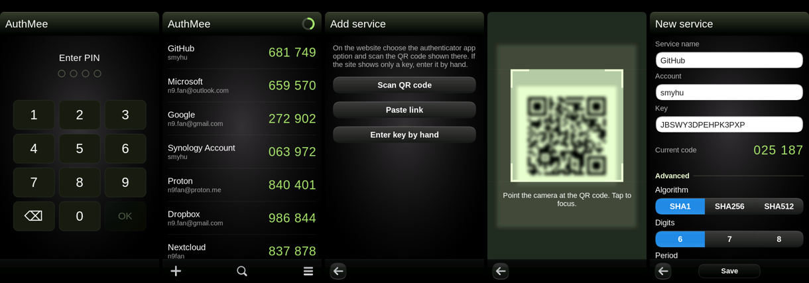

# AuthMee for Nokia N9

Two-step verification codes (TOTP, RFC 6238) for the Nokia N9 with MeeGo Harmattan PR1.3.



- Scan the QR code shown by a website with the built-in scanner (camera + ZBar), paste an
  `otpauth://` link, or type the key by hand. Google Authenticator exports
  (`otpauth-migration://`) add all their accounts at once.
- One list of services with their current codes. Tap a code to copy it. Hold a service to edit
  its name, move it up or down, or remove it. Pull the list down at its top to search.
- One shared countdown ring in the title bar: green, orange in the last 10 seconds, red in the
  last 5 seconds (the next code is shown under the current one). Services with a 60-second
  period get their own small ring.
- Optional PIN (4-8 digits): the saved keys are encrypted with AES-256 (key from PBKDF2), and
  the app locks again after a minute in the background.
- Encrypted backups (password) in `MyDocs/AuthMee`, visible over USB.
- Clock correction from a time server (NTP or TIME on port 37). The phone clock is not changed:
  the app only remembers the difference.
- SHA1 / SHA256 / SHA512, 6-8 digits, 30 or 60 second periods. Languages: English, Polish.

Designed and written by Claude (Anthropic) together with smyhu.

## Install

Copy the package to the phone and install it as root with `aegis-dpkg`
(from QTweak / hack-installer):

```
aegis-dpkg -i authmee-n9_0.1.0_armel.deb
```

The package carries an Aegis manifest that asks for camera access (`GRP::video`,
`GRP::pulse-access`), as MeeScan does.

## Files

| Path | What |
|---|---|
| `src/` | C++: codes (`otp.cpp`), storage and encryption (`store.cpp`), time server (`clock.cpp`), QR scanner (`scanner.cpp`), countdown ring (`ring.h`) |
| `qml/` | user interface, texts in `strings.js` |
| `zbar/` | the QR part of ZBar 0.23.93 (LGPL 2.1), unchanged except `zbar.h` (C++ wrappers left out) and `stubs.c` |
| `build.sh`, `packaging/make-deb.sh` | cross-build with clang against the Harmattan SDK, then the `.deb` |
| `tools/` | emulator scripts (qemu-arm + Xvfb), `mockntp.py` test time server |

### Saved data

`~/.local/share/authmee/accounts.dat`, one `otpauth://` link per line.

- without PIN: `AUTHMEE0\n` + lines, file mode 0600
- with PIN, and backups: `AUTHMEE1` | iterations (4 bytes, big endian) | salt (16) | IV (16) |
  AES-256-CBC data | HMAC-SHA256 (32). Key material = PBKDF2-HMAC-SHA1(PIN or password, salt,
  iterations, 64 bytes): the first 32 bytes are the AES key, the last 32 the HMAC key; the HMAC
  covers everything before it.

A backup can be opened on a PC with a few lines of Python (`hashlib.pbkdf2_hmac`) and
`openssl enc -d -aes-256-cbc -K <key> -iv <iv>`.

## Thanks

The scanner follows the approach of MeeScan by Nikolay Popov (2011). ZBar by Jeff Brown, QR
decoder by Timothy B. Terriberry.

## License

MIT, see `LICENSE`. ZBar is LGPL 2.1 (`zbar/COPYING`).
